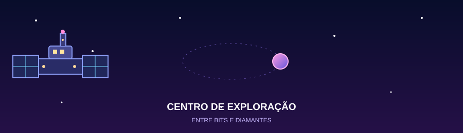

  

# ✦ Estação Espacial de Hellyne ✦

### Explorando o universo, uma linha de código por vez.

*Computer Science student | Mining Engineering student*

---

##  Sobre mim

Olá! Sou estudante de **Ciência da Computação na UNICAP** e **Engenharia de Minas na UFPE**.

Gosto de explorar novas ideias, aprender tecnologias e descobrir como a programação pode ajudar a resolver problemas em diferentes áreas do conhecimento.

Atualmente, estou construindo minha jornada na tecnologia, um projeto de cada vez. 🚀

## Atividade no GitHub

  
  

##  Mundos que estou explorando

-  Desenvolvimento de software
-  Inteligência Artificial
-  Análise de dados e bancos de dados
-  Cibersegurança
-  Tecnologia aplicada à mineração

##  Meu arsenal tecnológico

## Diário de bordo

Aprendendo continuamente.

 Transformando ideias em projetos.

Construindo minha trajetória como desenvolvedora.

<h3 align="center">📡 GitHub Activity</h3>

  

## Objetivo da missão

Unir tecnologia, ciência, criatividade e engenharia para desenvolver soluções e explorar possibilidades que vão além do óbvio.

*“A imaginação é a faculdade descobridora… ela penetra nos mundos invisíveis ao nosso redor, os mundos da Ciência.”* 🌠
- Ada Lovelace

  

